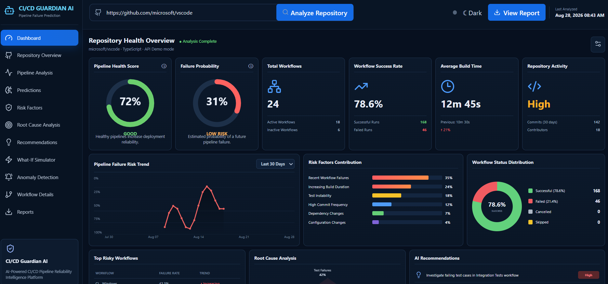

 

# JANANI M

**Artificial Intelligence & Data Science Undergraduate**

Rajalakshmi Institute of Technology, Chennai
## CONNECT WITH ME

---

---

## ABOUT ME

I am an Artificial Intelligence and Data Science undergraduate passionate about building intelligent applications and data-driven solutions to real-world problems.

My interests include machine learning, data analytics, data visualization, explainable AI, and software engineering. I enjoy developing practical projects, exploring emerging technologies, and continuously improving my technical and problem-solving skills.

- **Focus:** AI, Machine Learning, Data Science and Software Development
- **Interests:** Data Analytics, Power BI, Web Development and DevOps
- **Goal:** Build impactful, reliable and responsible technology solutions

---

## FEATURED PROJECTS

<table>
<tr>
<td width="50%" valign="top">

<h3>01 · LiverGuard AI</h3>

An explainable multimodal AI ecosystem concept for liver health risk assessment, disease progression prediction, personalized treatment support, and remote monitoring.

**Technologies**

</td>
<td width="50%" valign="top">

<h3>02 · CI/CD Guardian AI</h3>

A repository analysis concept that examines software projects and CI/CD workflows to help identify pipeline failures, bottlenecks, and opportunities for improvement.

**Technologies**

</td>
</tr>
<tr>
<td width="50%" valign="top">

<h3>03 · CyberOptima AI</h3>

A cybersecurity project focused on continuous cyber risk quantification, structured risk assessment, and actionable security insights.

**Focus Areas**

</td>
<td width="50%" valign="top">

<h3>04 · Smart ECG</h3>

A web application project for ECG signal processing and machine-learning-based analysis of ECG patterns.

**Technologies**

</td>
</tr>
</table>

---

## TECHNICAL SKILLS

**Programming**

**AI, Data & Visualization**

**Development Tools**

---

## GITHUB ANALYTICS

---

## ACHIEVEMENTS

- Second runner-up in a paper presentation on Virtual Memory.
- Participated in technology events and real-time problem-solving challenges.
- Completed the 1M1B Green Internship.
- MongoDB Basics certification.

---

### BUILDING INTELLIGENT SOLUTIONS FOR REAL-WORLD IMPACT

